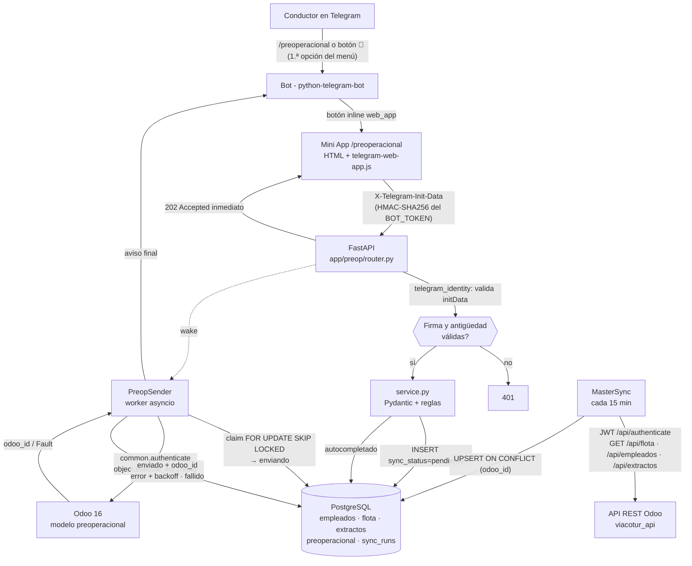

# Preoperacional vehicular: Mini App de Telegram → BD local → Odoo (XML-RPC)

Módulo `app/preop/` de `telegram_bot_operativos`. El conductor diligencia la inspección preoperacional desde una Mini App dentro de Telegram. El formulario se guarda primero en PostgreSQL y después un worker lo envía a Odoo, así que una caída de Odoo no hace perder datos ni deja al usuario esperando.

---

## 1. Arquitectura del sistema



**Stack:** Python 3.12, FastAPI, python-telegram-bot 22, SQLAlchemy 2 (ORM), PostgreSQL 16 (SQLite solo en pruebas), Pydantic 2, httpx y tenacity. Todo corre en un solo proceso (el contenedor `app` de `docker-compose.yml`), sin Celery ni Redis. La cola vive en la tabla `preoperacional`: el estado y `next_attempt_at` hacen de broker. Por eso cada reintento queda auditado y el despliegue no suma servicios. Si algún día hacen falta varias réplicas, `claim_batch` ya usa `FOR UPDATE SKIP LOCKED`.

**Por qué XML-RPC para escribir y REST para leer:** el `POST /api/preoperacional/register` de `viacotur_api` hace `sudo().create(data)` sin validar el payload. Con XML-RPC la escritura usa los permisos del usuario técnico, Odoo devuelve el `id` y sus errores se pueden clasificar (`Fault`). Las lecturas masivas usan la API REST, que ya entrega los datos aplanados y paginados.

## 2. Base de datos (`app/preop/models.py`)

| Tabla | Llave natural | Contenido |
|---|---|---|
| `empleados` | `odoo_id` (único) | `nombre`, `departamento_id`/`departamento`, `puesto_trabajo`, `codigo_pin` (índice, es el id de Telegram), `id_contract`, `contrato`, `contrato_temporal_id`, `contrato_temporal`, `responsable`, `responsable_mobile` |
| `flota` | `odoo_id` | `nombre`, `matricula`, `estado`, `numero_interno`, `parque_automotor`, `odometer_post NUMERIC(14,2)`, `tipo_solicitud` |
| `extractos` | `odoo_id` | conductores 1-3 con celular y estado de documentos, `contratos_list JSONB`, `estado`, `fecha_hora_inicio/fin TIMESTAMPTZ`, `responsable_cliente`, `responsable_cliente_mobile`, `vehiculo`, `vehiculo_id` |
| `acuerdos` | `odoo_id` | contrato (`agreement`) desde `/api/acuerdos`: `nombre`, `cliente`, `labrado_camioneta`, `labrado_buses` (labrado mínimo de llantas por tipo de vehículo) |
| `preoperacional` | `uuid` (único, idempotencia) | ver abajo |
| `preop_fotos` | (`preop_id`, `tipo`) único | foto de evidencia en `BYTEA` (`tipo='testigos'` → `testigos_img` de Odoo), `mime`, `tamano`, `sha256` |
| `ubicaciones` | — | ubicación compartida desde el chat (📍): `telegram_user_id`, `empleado_id`, `preop_id` (preoperacional de los últimos 10 min, si hay), `latitud`, `longitud`, `precision_m`, `recibido_at` |
| `sync_runs` | — | bitácora de cada sincronización: recibidos, upserts, inválidos, desactivados, error |

Las tres tablas maestras comparten estos campos: `id` (PK local), `company_id` (nombre que devuelve la API), `company_odoo_id`, `activo`, `synced_at`, `raw JSONB` (el objeto original), `created_at` y `updated_at`.

**`preoperacional`:**

- **Encabezado tipado:** `telegram_user_id`, `telegram_username` y `firma_nombre` (la firma sale del `initData` validado), las FK `empleado_id`, `vehiculo_id` y `extracto_id`, `contrato_odoo_id`, `fecha TIMESTAMPTZ`, `kilometraje NUMERIC(12,1) CHECK >= 0`, `numero_interno`, `observaciones`.
- **Inspección (JSONB, validada):** `checklist` guarda los 56 ítems de luces, frenos, niveles, documentos, seguridad, etc. como `{campo_odoo: "conforme" | "no conforme" | "no aplica" | ...}`. `llantas` guarda labrado (mm) y presión (psi) de cada llanta. `extra` recibe atributos dinámicos. `no_conformes` es un conteo calculado para poder filtrar.
- **Auditoría de sync:** `sync_status` (`pendiente → enviando → enviado | error → fallido`), `odoo_id` (único), `odoo_name` (PRE-xxxx), `error_log`, `attempts`, `next_attempt_at`, `last_attempt_at`, `sent_at`.
- **Índices:** `(sync_status, next_attempt_at)` para la cola, `(vehiculo_id, fecha)`, `telegram_user_id` y GIN sobre `checklist`.

Decisiones de diseño:

- **El checklist va en JSONB y no en 56 columnas.** El catálogo `app/preop/checklist.py` es la fuente única: valida el payload con Pydantic, define el formulario (`GET /api/preop/form`) y fija qué campos se envían a Odoo. Las claves son los nombres técnicos de Odoo, así que el mapeo es directo. Agregar un ítem significa tocar una sola línea, sin migración. Para consultar, el índice GIN permite buscar con `checklist @> '{"frenos": "no conforme"}'`.
- **`extractos.vehiculo_id` no tiene FK física.** Un extracto puede apuntar a un vehículo de otra compañía que no se sincroniza, y una FK rompería el UPSERT. La relación ORM (`Extracto.flota`) es `viewonly`.
- **Nunca se borran filas maestras.** Las que dejan de llegar quedan con `activo = false`, para que los preoperacionales históricos sigan resolviendo su empleado o vehículo.
- **La foto va en una tabla aparte** (`preop_fotos`), no como columna de `preoperacional`: el binario no se carga al leer la cola y se pueden sumar tipos de foto sin migrar.
- **La ubicación se guarda solo en la BD del bot** (el modelo `preoperacional` de Odoo no tiene campos de ubicación). Se asocia al preoperacional enviado por el mismo usuario en los últimos 10 minutos.
- **Esquema:** `Base.metadata.create_all` es idempotente y crea tablas e índices que falten. Para cambiar columnas de tablas existentes, agregar Alembic (`alembic init`, `target_metadata = Base.metadata`).

## 3. Ingesta y sincronización (`app/preop/rest_client.py`, `app/preop/etl.py`)

1. `POST /api/authenticate` con `{login, password}` (credenciales de `.env`) devuelve un JWT que vence a las **24 h**. El cliente lee el claim `exp` del token y pide uno nuevo **10 min antes** de que venza, sin esperar al rechazo; si el token no trae `exp`, asume 24 h desde su emisión. Si aun así llega un 401 (token revocado, relojes desfasados), renueva una vez y repite la petición. Cada pasada de sincronización abre además un cliente nuevo, con su propio token.
2. Se piden `GET /api/flota`, `/api/empleados` y `/api/extractos` con `page`, `page_size` y `company_id`, recorriendo todas las páginas hasta cubrir `total`.
3. Reintentos con tenacity: 5 intentos con backoff exponencial y jitter ante errores de red, timeouts, 5xx y 429. Los demás 4xx no se reintentan.
4. Un **404 JSON** (`{"detail": "Informacion no encontrada."}`) se interpreta como "sin datos". Un **404 HTML** es un error, porque tratarlo como vacío desactivaría toda la tabla.
5. Cada objeto pasa por un modelo Pydantic tolerante (`schemas.*Api.to_row`) que aplana los anidados. Por ejemplo, `responsable` puede llegar como `"Ana"` o como `{"name": "Ana", "mobile": "300…"}`, y en el segundo caso se extrae `responsable_mobile`. Un objeto inválido se omite y se registra en el log.
6. El UPSERT usa `INSERT … ON CONFLICT (odoo_id) DO UPDATE` en lotes de 500, con una transacción por entidad y compañía.
7. Después se desactivan los registros de esa compañía que no llegaron, salvo que la API haya devuelto 0 registros y la tabla tenga activos.
8. En extractos, si falta `vehiculo_id`, se resuelve contra `flota.nombre` cuando el nombre es único.

> **Campos anidados de la API (`viacotur_api/controllers/event.py`).** `responsable.mobile` (empleados), `responsable_cliente.mobile` y `vehiculo.id` (extractos) se van a exponer en el endpoint como objetos, p. ej. `"vehiculo": {"id": v.id, "name": v.name}` y `"responsable": {"name": p.name, "mobile": p.mobile_phone}`. El ETL ya los lee en esa forma (probado con datos reales de qa2) y no requiere cambios. Mientras el endpoint siga entregando texto plano, los celulares quedan en `NULL` y `vehiculo_id` se resuelve por nombre del vehículo.

Ejecución manual: `python -m app.preop.etl` (con Docker: `docker compose exec app python -m app.preop.etl`). Sale con código 1 si alguna entidad falló.

### Introspección de `/api/preoperacional`

El modelo del formulario se construyó a partir del código de Odoo (modelo `preoperacional` + `preoperacional_inherit`) y se verificó con `fields_get` contra qa2: los 76 campos y todas sus opciones coinciden. Si el endpoint cambia, `scripts/introspect_endpoint.py` descarga una muestra, infiere los tipos y genera los modelos SQLAlchemy y Pydantic:

```bash
python scripts/introspect_endpoint.py /api/preoperacional --company 1 --sample 200 --class PreoperacionalApi
python scripts/introspect_endpoint.py --file respuesta.json --class PreoperacionalApi   # sin red
```

## 4. Backend API y conector Odoo

### Mini App (`app/static/preoperacional.html`)

Formulario por pasos con barra de progreso e identidad VIACOTUR (logo y paleta azul), como el bot de referencia `@viacoturform_bot`:

1. **Información General:** conductor y responsable bloqueados y aviso "Conductor validado con extractos aprobados". Luego, como en la referencia: **Contrato** (los de todos los extractos aprobados y vigentes del conductor) → **Vehículo**, en tarjetas con placa, marca/modelo, número interno y "DISPONIBLE" (uno o varios, según los extractos que incluyen ese contrato) → número interno (solo lectura) y **Odómetro actual** con teclado numérico. El odómetro debe ser **mayor o igual** al último registrado en Odoo (último `km_end` del Pos-Operacional, `odometer_post` de `/api/flota`); si es menor, "Siguiente" queda deshabilitado y el servidor también lo rechaza.
2. **Verificación de Elementos:** cuatro pestañas fijas arriba: **Documentos · Rines/Llantas · Equipo · Vehículo** (esta agrupa Extintores, Chasis y cabina, Niveles y Sistema eléctrico). Los controles siguen el patrón del bot de referencia:
   - **Casilla** (46 ítems): marcada = `conforme`; **sin marcar = `no conforme`** al enviar a Odoo (abre plan de acción).
   - **Radio** (9 ítems): Chaleco reflectivo, Kit control derrames y Testigos del tablero (Conforme / No conforme); Pico y pala, Eslingas, Cables de arranque, **Cámaras** (campo `camaras`), Barra antivuelco y Extintor N.º 2 (Conforme / No conforme / No aplica). Un radio sin elegir no se envía.
   - Cada ítem muestra su criterio de no conforme. "Marcar pestaña conforme" marca la pestaña visible.
   - **Llantas:** labrado (mm, teclado decimal) y presión (PSI, teclado numérico) de las llantas 1–4 y la de repuesto (`llanta_7` / `llanta_rep_pre`); las llantas 5 y 6 aparecen si el conductor responde **Sí** a "¿El vehículo tiene llantas internas?". Ya no se preguntan "¿La repuesto tiene presión?" (`llanta_rep_pre_act`) ni "¿Tiene cámaras?" (`camaras_new`).
   - **Alerta de labrado:** cada llanta muestra su mínimo y alerta si está por debajo. El mínimo sale del acuerdo del contrato según el tipo de vehículo (`fleet.vehicle.type`): `labrado_buses` para bus, buseta y microbus; `labrado_camioneta` para los demás. Si el acuerdo tiene 0, se usa el de Odoo (1,6 mm; 2,0 mm en internas). Es solo una alerta: Odoo sigue aplicando sus propios umbrales al crear el registro.
3. **Observaciones y Evidencia:** observaciones libres (sin texto, se envían en blanco) y foto de testigos del tablero (única foto; recomendada, no obligatoria).
4. **Resumen de la Inspección:** información general y una tarjeta por sección con ✔ (conforme), **!** rojo (casilla sin marcar, no conforme o radio sin elegir) y **N/A**; tabla de labrado/presión con alerta bajo el mínimo; "Imagen subida: 0/1 o 1/1". Al tocar una alerta vuelve al ítem. **Completar inspección** envía aunque haya alertas, previa confirmación.

El conductor puede enviar uno o varios preoperacionales (no hay límite diario).

**Aviso al jefe por Telegram:** cuando el registro llega a Odoo con ítems no conformes o llantas bajo el mínimo del contrato, el bot avisa al jefe inmediato (conductor, vehículo, PRE-xxxx y lista de hallazgos). El jefe se identifica por el nombre del responsable del empleado y debe tener su **id de Telegram en el PIN** (`hr.employee.pin`) y haber abierto el bot al menos una vez; si no, se registra en el log.

Sin empleado o sin extracto aprobado se muestra una pantalla de bloqueo que explica qué hacer. Al terminar, recuerda enviar la ubicación desde el chat (📍, dentro de 10 minutos).

### Seguridad de la Mini App (`app/webapp_auth.py`, dependencia `telegram_identity`)

- `secret = HMAC_SHA256(key="WebAppData", msg=BOT_TOKEN)` y `hash = HMAC_SHA256(secret, data_check_string)`, donde `data_check_string` son los pares `clave=valor` ordenados, sin `hash` y unidos con `\n`. La comparación es en tiempo constante (`hmac.compare_digest`).
- `auth_date` no puede tener más de `PREOP_AUTH_MAX_AGE_SECONDS` de antigüedad (3600 s por defecto, porque el formulario es largo) ni estar en el futuro.
- La identidad (id, nombre, usuario) sale **solo** del `initData`. El cuerpo no acepta `telegram_user_id`, porque `extra="forbid"` lo rechaza.
- Autorización: el empleado debe estar activo y su `codigo_pin` debe ser igual al id de Telegram (tabla local).
- **Vehículo desde el extracto aprobado:** el extracto es obligatorio y debe estar **aprobado** (`estado = approved`), vigente (±1 día) y tener al empleado como conductor, segundo o tercer conductor. La API entrega el conductor por nombre: se compara sin tildes, mayúsculas ni espacios extra. Cuando `viacotur_api` exponga el id del conductor, esta comparación debe pasar a ser por id. El vehículo se toma del extracto y no se puede cambiar. Si el extracto trae varios contratos, hay que elegir uno; si trae uno, se asigna solo.
- **Foto de testigos (opcional):** llega en base64 (JPEG o PNG, máximo 3 MB, validada por su firma real, no por lo que diga el cliente). La Mini App la comprime antes de enviarla (lado mayor 1600 px, unos 300 KB).
- La Mini App pinta los datos con `textContent`, nunca con `innerHTML`.

| Ruta | Respuesta |
|---|---|
| `GET /preoperacional` | HTML de la Mini App |
| `GET /api/preop/form` | catálogo de secciones, ítems, opciones y medidas |
| `GET /api/preop/context` | conductor y responsable, `validado` y extractos aprobados del conductor con su vehículo y contratos |
| `GET /static/viacotur-logo.png` | logo de la cabecera |
| `POST /api/preop` | **202** con `{id, uuid, sync_status: "pendiente", no_conformes, duplicado}`; 401, 403, 409 o 422 si se rechaza |
| `GET /api/preop/{uuid}` | estado de un envío propio |

### Conector XML-RPC (`app/preop/odoo_writer.py`)

`OdooWriter.create_preoperacional(uuid, vals, fecha, incierto)`:

1. `common.authenticate`. El uid queda en caché y se invalida si Odoo responde `AccessDenied`.
2. Idempotencia: primero se busca el external id `telegram_bot_operativos.preop_<uuid>` en `ir.model.data`. Si el intento anterior fue incierto (timeout después de enviar), también se busca por llave natural: empleado, vehículo, odómetro y `create_date >=` fecha de envío − 2 min.
3. `execute_kw('preoperacional', 'create', [vals])`, con la foto en `testigos_img`. Odoo aplica sus reglas (labrado mínimo, `no conforme` → plan de acción, actividades, odómetro).
4. Se registra el external id y se lee `name`.

Clasificación de errores:

- `OdooTransientError` (red, timeout, HTTP 5xx, bloqueo o serialización de la BD, credenciales): 3 reintentos inmediatos con tenacity. Después se reintenta en ciclos siguientes con backoff de 30 s · 2ⁿ (máximo 1 h), hasta `PREOP_MAX_ATTEMPTS`, y luego pasa a `fallido`.
- `OdooPermanentError` (ValidationError, UserError, campo inexistente): pasa a `fallido` de inmediato, con la última línea del traceback de Odoo en `error_log`.

El conductor recibe un mensaje en el chat cuando su registro llega a `enviado` (con el número PRE-xxxx y los no conformes) o a `fallido`.

El cliente de lectura `app/odoo_client.py` del validador QR sigue siendo **solo lectura** (lo comprueba `tests/test_odoo_client_readonly.py`). La escritura queda aislada en `OdooWriter`, que puede usar credenciales propias (`ODOO_WRITE_USERNAME` / `ODOO_WRITE_PASSWORD`).

## 5. Despliegue y operación

### Estructura

```
app/preop/
  checklist.py     catálogo de ítems (fuente única: validación, formulario y mapeo a Odoo)
  models.py        ORM: empleados, flota, extractos, preoperacional, sync_runs
  db.py            motor y sesiones; create_all
  schemas.py       Pydantic: entrada estricta de la Mini App y normalización tolerante de la API
  rest_client.py   API REST de Odoo (JWT, paginación, tenacity)
  etl.py           transformación + UPSERT + desactivación (CLI: python -m app.preop.etl)
  odoo_writer.py   XML-RPC create con idempotencia y clasificación de errores
  service.py       recepción, autorización, cola (claim/send/requeue), contexto de la Mini App
  router.py        endpoints FastAPI + dependencia de seguridad initData
  worker.py        PreopSender y MasterSync (asyncio); CLI de operación
app/static/preoperacional.html   Mini App
scripts/introspect_endpoint.py   generador de modelos a partir de un endpoint
tests/test_preop.py              29 pruebas (SQLite; opcional PostgreSQL real)
```

### `.env` (además de las variables existentes)

| Variable | Valor por defecto | Uso |
|---|---|---|
| `ODOO_API_URL` | `ODOO_URL` | Base de la API REST |
| `ODOO_API_LOGIN` / `ODOO_API_PASSWORD` | — | Usuario de la API. **Contraseña real**: `/api/authenticate` es un login interactivo y no acepta API keys. Sin estas variables no hay sincronización maestra |
| `ODOO_API_COMPANY_IDS` | `1` | Compañías a sincronizar, p. ej. `1,2` |
| `ODOO_API_PAGE_SIZE` / `ODOO_API_TIMEOUT_SECONDS` | `500` / `60` | |
| `MASTER_SYNC_INTERVAL_SECONDS` | `900` | |
| `ODOO_WRITE_USERNAME` / `ODOO_WRITE_PASSWORD` | `ODOO_USERNAME` / `ODOO_PASSWORD` | Usuario XML-RPC con permiso de crear `preoperacional` (API key válida) |
| `PREOP_WORKER_INTERVAL_SECONDS` | `10` | |
| `PREOP_MAX_ATTEMPTS` | `8` | |
| `PREOP_SENDING_LEASE_SECONDS` | `300` | Un registro en `enviando` más viejo que esto se retoma |
| `PREOP_AUTH_MAX_AGE_SECONDS` | `3600` | |
| `PREOP_BASE_URL` | `SCANNER_BASE_URL` | HTTPS público que sirve `/preoperacional` |

### Despliegue

1. `git pull` y completar `.env` (ver arriba).
2. `docker compose up -d --build`. Las tablas nuevas se crean solas al arrancar.
3. Primera carga de maestros sin esperar al ciclo: `docker compose exec app python -m app.preop.etl`.
4. Comprobar: `docker compose exec db psql -U watcher -d watches -c "SELECT entidad, status, recibidos, upserts, error_log FROM sync_runs ORDER BY id DESC LIMIT 6"`.

### Registrar la Mini App en @BotFather

La Mini App se abre desde un **botón inline `web_app`** que envía el bot (`/preoperacional` o el botón 📝, primera opción del menú de @OperativosViacoturBot), así que no hace falta registrar nada para que funcione. Opcionalmente:

1. `@BotFather → /mybots → <bot> → Bot Settings → Menu Button → Configure menu button`: URL `https://<PREOP_BASE_URL>/preoperacional` y texto `Preoperacional`. Así se abre desde el botón de menú del chat.
2. Para un enlace directo `t.me/<bot>/preop`: `/newapp`, elegir el bot, título, descripción, imagen 640×360, URL `https://<PREOP_BASE_URL>/preoperacional` y nombre corto `preop`.
3. `/setdomain` no es necesario (es para Login Widget). La URL **debe ser HTTPS** con certificado válido: en QA, túnel cloudflared al puerto 8011; en producción, el subdominio detrás de nginx.

Los comandos del bot (`/preoperacional` incluido) se registran solos al arrancar (`set_my_commands`).

### Operación

| Tarea | Comando |
|---|---|
| Cola pendiente | `SELECT sync_status, count(*) FROM preoperacional GROUP BY 1;` |
| Ver fallidos | `SELECT id, uuid, attempts, error_log FROM preoperacional WHERE sync_status='fallido';` |
| Reencolar tras corregir | `docker compose exec app python -m app.preop.worker --requeue 12 15` (o `--requeue-all`) |
| Procesar la cola a mano | `docker compose exec app python -m app.preop.worker --once` |
| Sincronizar maestros | `docker compose exec app python -m app.preop.etl` |
| Pruebas contra PostgreSQL | `PREOP_TEST_DATABASE_URL=postgresql+psycopg2://…/bd_desechable pytest tests/test_preop.py` (vacía la BD) |

### Riesgos y pendientes

- **Credenciales de la API REST:** van en `.env` (`ODOO_API_LOGIN`/`ODOO_API_PASSWORD`). El usuario actual de XML-RPC usa API key, que `/api/authenticate` rechaza (verificado: 401); hace falta un usuario con contraseña y permiso de lectura sobre flota, empleados y extractos (los endpoints leen con los permisos del usuario del token, sin `sudo`).
- **Deduplicación por llave natural:** solo se usa cuando el intento anterior fue incierto. Si el mismo conductor envía dos formularios con el mismo vehículo y el mismo odómetro mientras Odoo está caído, el segundo se asocia al primero. En la práctica es el mismo formulario reenviado.
- **El usuario técnico necesita permiso de crear `ir.model.data`** para la deduplicación por external id (en qa2 lo tiene). Sin ese permiso se registra una advertencia y se sigue solo con la llave natural.
- **Prueba en qa2 (2026-11-20):** de punta a punta con datos reales: maestros → `GET /api/preop/context` y `POST /api/preop` con `initData` firmado con el token real → worker → XML-RPC. Se creó `PRE-000009912` (id 684) con empleado, vehículo, extracto, contrato, jefe inmediato, odómetro, checklist y llantas correctos. Odoo lo calculó como `no conforme` con `plan_accion`, igual que el conteo local. Un reenvío forzado reutilizó el mismo registro gracias al external id (sin duplicado). La sincronización REST real también se probó en qa2 con las credenciales de `.env` (JWT obtenido; 269 vehículos, 12 empleados y 1 extracto, sin inválidos). Pendiente: abrir la Mini App desde un móvil, una vez publicada por HTTPS.
